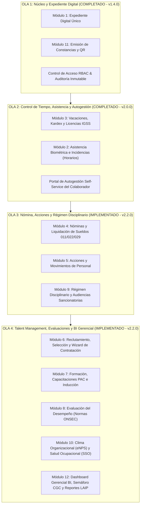

# Core Humanis App &bull; Secretaría de Comunicación Social de la Presidencia (SCSPR)

Documentación del Módulo de Gestión Integral de Recursos Humanos, Expedientes Digitales, Contratación Asistida, Hoja de Ruta por Olas y Emisión Documental con Código QR adaptado a la normativa gubernamental de la República de Guatemala.

---

## 1. Visión General del Proyecto

**Core Humanis** es la plataforma tecnológica institucional centralizada para la administración 360° del talento humano en la Secretaría de Comunicación Social de la Presidencia (**SCSPR**). El sistema automatiza el ciclo de vida completo del servidor público y contratista desde su postulación y contratación hasta la liquidación, evaluaciones y archivo inmutable de expedientes.

### Principales Pilares Arquitectónicos:
* **Frontend**: Vue 3 (Composition API), Vite, Pinia, Tailwind CSS y componentes reactivos con diseño estético Hi-Fi.
* **Backend API**: Node.js / Express con arquitectura canónica RESTful Nivel 3 de Richardson (recursos granulares y enlaces hipermedia HATEOAS).
* **Base de Datos**: PostgreSQL (`db_core_humanis`) con esquema relacional estricto y triggers de auditoría inmutable.
* **Motor Documental**: Inyección dinámica en plantillas OpenXML (`easy-template-x` / `JSZip`) y renderizado headless a PDF vía `LibreOffice` con código QR de validación pública criptográfica (SHA-256).

---

## 2. Hoja de Ruta de Desarrollo e Implementación por Olas

El desarrollo de la plataforma se rige por la matriz progresiva definida en la especificación técnica de requerimientos ([`docs/Requerimientos de Implementacion Sistema Completo - Core Humanis.md`](./docs/Requerimientos%20de%20Implementacion%20Sistema%20Completo%20-%20Core%20Humanis.md)):



---

## 3. Matriz de Estado de Desarrollo del Sistema (`v2.2.0`)

El avance de los módulos institucionales respecto a la especificación de requerimientos se sintetiza a continuación:

| Módulo | Nombre del Módulo | Estado de Desarrollo | Componentes y Funcionalidades Implementadas |
| :--- | :--- | :---: | :--- |
| **Módulo 1** | **Expediente Digital Único** | 🟢 **100% Completado** | Ficha 360° (`/collaborators/:id`), historial laboral, carga de atestados obligatorios (DPI, RTU, CGC) y búsqueda rápida. |
| **Módulo 2** | **Asistencia Biométrica** | 🟢 **100% Completado** | Registro e ingesta de marcas biométricas (`/attendance`), tolerancia reglamentaria de 15 minutos y semáforo de puntualidad. |
| **Módulo 3** | **Vacaciones & Licencias** | 🟢 **100% Completado** | Kardex de saldos acumulados (`/vacations`), cálculo inteligente de días hábiles excluyendo asuetos y permisos IGSS (`/leaves`). |
| **Módulo 4** | **Nómina & Compensaciones** | 🟡 **Fase Inicial (Ola 3)** | Estructura base de sueldos y facturas 029 (`/payrolls`). Generador automático de planillas e IGSS en desarrollo. |
| **Módulo 5** | **Acciones de Personal** | 🟡 **Fase Inicial (Ola 3)** | Emisión preliminar de nombramientos (`/personnel-actions`) y actas de toma de posesión. |
| **Módulo 6** | **Reclutamiento & Selección** | 🟢 **Completado (Flujo Asistido)** | Asistente Wizard de Contratación (`/hiring`) de 4 pasos regulado por `documentation/flujo_contratacion_y_origen_candidatos.md`. |
| **Módulo 7** | **Capacitación & Desarrollo** | 🟢 **Completado** | Seguimiento del Plan Anual de Capacitación (`/trainings`), diplomados y horas acumuladas. |
| **Módulo 8** | **Evaluación del Desempeño** | 🟢 **Completado** | Instrumento de evaluación de competencias (`/evaluations`) parametrizado conforme a ONSEC. |
| **Módulo 9** | **Régimen Disciplinario** | 🟢 **Completado** | Tramitación del debido proceso (`/disciplinary`), amonestaciones y audiencias de descargo. |
| **Módulo 10** | **Clima & Bienestar Ocupacional**| 🟢 **Completado** | Encuestas confidenciales (`/climate`), indicador eNPS y Salud y Seguridad Ocupacional (`/occupational-health` - A.G. 229-2014). |
| **Módulo 11** | **Emisión Documental & QR** | 🟢 **100% Completado** | Emisión inmediata de constancias de ingresos y laborales (`/certificates`), firma SHA-256 e inyección de QR de verificación pública. |
| **Módulo 12** | **Dashboard BI & Auditoría** | 🟢 **100% Completado** | Tablero ejecutivo (`/executive-dashboard`), Semáforo CGC de 180 días (`/alerts`) y Registro de Auditoría Inmutable (`/audit-logs`). |

---

## 4. Marco Normativo Legal y Regla de Negocio BR-04

En cumplimiento de las auditorías de la **Contraloría General de Cuentas (CGC)**:
* **Personal en Relación de Dependencia (011, 021, 022, 031)**: Se emite "Constancia Laboral", devengan "salario/sueldo" y están afectos a descuentos de ley.
* **Contratistas por Servicios Técnicos y Profesionales (029, 183, 189)**: Se emite "Constancia de Prestación de Servicios". Por regla estricta **BR-04**, queda prohibido utilizar palabras como *salario*, *sueldo*, *empleado*, *trabajador* o *jornada*, debiendo emplearse exclusivamente *honorarios* y *prestador de servicios*.

---

## 5. Documentación de Referencia y Flujos Detallados

Para profundizar en la lógica de negocio y arquitectura, consulte las carpetas de documentación del proyecto:

1. **Flujo de Contratación Asistida**: [`documentation/flujo_contratacion_y_origen_candidatos.md`](./documentation/flujo_contratacion_y_origen_candidatos.md)
   - Especifica las 4 etapas del Asistente Wizard y la dualidad de origen del candidato (Vía Oposición/Terna vs Contratación Directa).
2. **Catálogo y Reglas de Plantillas**: [`documentation/plantillas_y_formatos.md`](./documentation/plantillas_y_formatos.md)
   - Clasificación de formatos institucionales oficiales, reemplazos OpenXML e inyección del código QR de validación.
3. **Requerimientos Formales de Software**:
   - Ola 1 MVP: [`docs/Requerimientos de Implementacion Ola 1 - Core Humanis.md`](./docs/Requerimientos%20de%20Implementacion%20Ola%201%20-%20Core%20Humanis.md)
   - Sistema Robusto: [`docs/Requerimientos de Implementacion Sistema Completo - Core Humanis.md`](./docs/Requerimientos%20de%20Implementacion%20Sistema%20Completo%20-%20Core%20Humanis.md)

---

## 6. Guía de Limpieza de Datos Demo y Poblamiento de Datos Reales

### 6.1. Estado Actual de las Fuentes de Datos

* **Datos de Prueba Iniciales**: Ubicados en [`database/init_core_humanis.sql`](../database/init_core_humanis.sql), contienen 3 colaboradores demo con IDs prefijados (`88888888-...`) para pruebas del sistema.
* **Catálogos Oficiales Extraídos**: Ubicados en [`database/seed_catalogs_core_humanis.sql`](../database/seed_catalogs_core_humanis.sql), contienen **29 Unidades Administrativas**, **53 Puestos Nominales** y **85 Puestos Funcionales**.
* **Personal y Contratos Activos**: Ubicados en [`database/seed_core_humanis_rawdata.sql`](../database/seed_core_humanis_rawdata.sql), contienen los **228 colaboradores/contratos** extraídos y validados tras auditar las 60 pestañas de los archivos Excel institucionales (`raw-data`).

### 6.2. Pasos para Reiniciar y Poblar la Base de Datos PostgreSQL

#### Paso 1: Limpieza de Datos Anonimizados de Prueba
Ejecute la siguiente consulta SQL en la base de datos `db_core_humanis`:

```sql
BEGIN;

-- 1. Eliminar relaciones laborales, constancias emitidas y expedientes de prueba
TRUNCATE TABLE expediente_documentos, constancias_emitidas, relaciones_laborales, personas CASCADE;

-- 2. Limpiar catálogos preliminares para reinicio estandarizado
TRUNCATE TABLE puestos_funcionales, puestos_nominales, unidades_administrativas CASCADE;

COMMIT;
```

#### Paso 2: Carga de Catálogos Oficiales y Data Real
Desde la terminal o consola de PostgreSQL (`psql`), aplique los scripts de poblamiento en el siguiente orden estricto:

```bash
# 1. Poblar Catálogos Base (Unidades Administrativas, Puestos Nominales y Funcionales)
psql -U postgres -d db_core_humanis -f database/seed_catalogs_core_humanis.sql

# 2. Poblar Personal Activo, Histórico y Contratos Reales (228 Colaboradores/Contratos)
psql -U postgres -d db_core_humanis -f database/seed_core_humanis_rawdata.sql
```

---

## 7. Estructura de Plantillas Oficiales de Impresión (.docx)

Las plantillas oficiales para generación automatizada se encuentran almacenadas en la carpeta:
* [`core-humanis-app/template/`](./template)

Cada archivo utiliza la convención de nomenclatura `kebab-case` para ser referenciado dinámicamente desde la API Node.js (`api/src/services/certificates.service.js` y `api/src/services/templates.service.js`):

* `plantilla-constancia-laboral.docx` (Renglones 011/021/022/031 - Relación de Dependencia)
* `plantilla-constancia-029-sg18.docx` (Renglones 029/183/189 - Servicios Técnicos y Profesionales)
* `plantilla-contrato-022.docx` / `plantilla-contrato-029.docx` (Modelos de Contratos)
* `boleta-solicitud-vacaciones.docx` (Solicitud de Vacaciones)
* `acta-notarial-de-declaracion-jurada-029-final-con-negrita.docx` (Declaración Jurada Notarial)

---

## 8. Cambios en Docker Compose (Dev vs. Producción)

Para mejorar la velocidad de desarrollo sin afectar el pipeline de **CI/CD en Producción**, el comportamiento de Docker Compose se divide de la siguiente manera:

### ⚙️ 1. Entorno de Desarrollo (Local)
* **Archivo**: `docker-compose.override.yml` *(Docker Compose lo aplica automáticamente al ejecutar `docker compose up` en local)*.
* **Hot Reloading Activo**: Se configuraron montajes de volumen local para la API (`./api`) y el Frontend (`./core-humanis-app`). Cualquier cambio de código se refleja de inmediato sin necesidad de reconstruir las imágenes Docker.
* **Configuración Dev**: Utiliza `nginx/default.dev.conf` y `Dockerfile.dev` para facilitar la recarga en caliente y depuración local.

### 🚀 2. Entorno de Producción / CI/CD (Servidores)
* **Archivo**: `docker-compose.yml` *(Producción no utiliza ni requiere `docker-compose.override.yml`)*.
* **Imágenes Inmutables**: Se construyen imágenes cerradas e independientes copiando todo el código compilado sin volúmenes de desarrollo.
* **Cero Impacto en CI/CD**: Garantiza despliegues seguros, limpios e idénticos en el servidor de producción.
