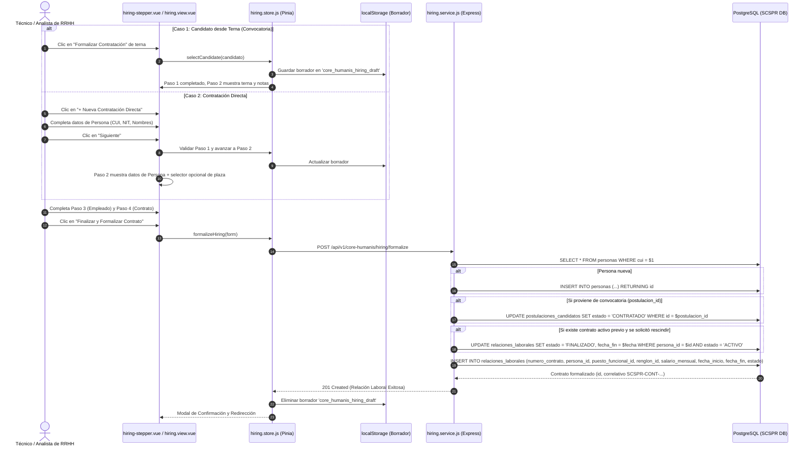
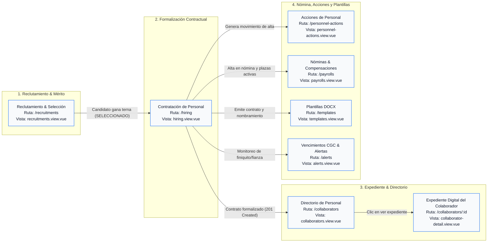

# Flujo de Contratación y Origen de Candidatos (Paso 2)

## 1. Resumen Ejecutivo y Marco Normativo

El **Módulo de Contratación de Personal** de **Core Humanis** en la Secretaría de Comunicación Social de la Presidencia (**SCSPR**) implementa un asistente de 4 pasos regulado por el principio institucional de integridad de identidad y régimen contractual:

```
[1. Persona] ──▶ [2. Candidato & Terna] ──▶ [3. Empleado] ──▶ [4. Contrato]
```

### Reglas Clave del Sistema:
1. **Identidad Única (CUI/DPI):** No pueden existir dos personas registradas con el mismo Código Único de Identificación.
2. **Exclusividad Contractual:** Ningún colaborador puede poseer dos contratos activos simultáneamente en la institución. Si tiene uno previo activo, el sistema exige rescindirlo o cerrarlo antes de formalizar el nuevo.
3. **Dualidad de Origen para el Paso 2 (Candidato):** El candidato que se procesa en el **Paso 2** proviene de **dos orígenes distintos** según la modalidad de reclutamiento:
   - **Origen A (Vía Oposición / Pipeline de Convocatorias):** Candidato que aprobó las etapas de evaluación (curricular, técnica y entrevista) dentro de una convocatoria pública y fue preseleccionado en terna (`postulaciones_candidatos`).
   - **Origen B (Vía Contratación Administrativa Directa):** Ciudadano capturado directamente en el **Paso 1** (vía CUI/DPI, NIT y datos de contacto), permitiendo asociarle opcionalmente una plaza abierta o tramitar un alta externa directa sin oposición previa.

---

## 2. Diagrama de Origen de Candidatos (Paso 2)

El siguiente diagrama detalla cómo se alimenta el Paso 2 desde ambos flujos y cómo confluyen en la formalización contractual:

```mermaid
flowchart TD
    %% Origen A: Convocatoria por Oposición
    subgraph OrigenA ["Canal A: Pipeline de Oposición y Convocatorias"]
        direction TB
        CP["convocatorias_plazas<br/>(Plaza publicada en Convocatoria)"]
        PC["postulaciones_candidatos<br/>(Postulación ciudadana)"]
        EVAL["Fase de Evaluación<br/>Curricular (20) + Técnica (40) + Entrevista (40)"]
        TERNA["Estado: PRESELECCIONADO / SELECCIONADO<br/>(Candidato en Terna)"]
        
        CP --> PC
        PC --> EVAL
        EVAL --> TERNA
    end

    %% Interfaz de Selección
    UI_TERNA["Vista: Pestaña 'Candidatos en Terna'<br/>(Listado de elegibles con puntaje >= 70)"]
    TERNA --> UI_TERNA

    BTN_FORMALIZAR["Acción: Clic en 'Formalizar Contratación'"]
    UI_TERNA --> BTN_FORMALIZAR

    %% Origen B: Contratación Directa
    subgraph OrigenB ["Canal B: Contratación Administrativa Directa"]
        direction TB
        BTN_DIRECTA["Acción: Clic en '+ Nueva Contratación Directa'"]
        STEP1["Paso 1: Identificación de Persona<br/>- CUI / DPI (13 dígitos)<br/>- NIT, Nombres, Apellidos<br/>- Correo, Teléfono, Dirección"]
        BTN_DIRECTA --> STEP1
    end

    %% Confluencia en Paso 2
    subgraph WizardHiring ["Asistente de Contratación (hiring-stepper.vue)"]
        direction TB
        STEP2["Paso 2: Candidato & Terna<br/>(hiringStore.selectedCandidate || datos del Paso 1)"]
        
        OPCION_A["Ruta A: Convocatoria Vinculada<br/>- Se muestran Punteos de Selección<br/>- Se enlaza a la Convocatoria Oficial<br/>- Sugiere puesto y salario convenido"]
        OPCION_B["Ruta B: Directa Externa<br/>- Muestra tarjeta de la persona capturada<br/>- Selector opcional de plaza disponible<br/>- 'Contratación Directa (Sin Oposición)'"]
        
        STEP2 --> OPCION_A
        STEP2 --> OPCION_B
        
        STEP3["Paso 3: Empleado Institucional<br/>- Código de Empleado (SCSPR-EMP-XXX)<br/>- Puesto Funcional<br/>- Unidad Administrativa"]
        
        STEP4["Paso 4: Relación Laboral / Contrato<br/>- Renglón Presupuestario (011, 022, 029, 189)<br/>- Salario Mensual y Vigencia<br/>- Validación de Contrato Activo Previo"]
        
        OPCION_A --> STEP3
        OPCION_B --> STEP3
        STEP3 --> STEP4
    end

    BTN_FORMALIZAR -->|"Pre-llena Paso 1 y Paso 2"| STEP2
    STEP1 -->|"Avanza a Paso 2 con Persona"| STEP2

    %% Backend y Base de Datos
    subgraph Persistencia ["Formalización en Base de Datos (hiring.service.js)"]
        direction TB
        DB_PERSONA["personas<br/>(Garantía de CUI único / Activo)"]
        DB_POSTULACION["postulaciones_candidatos<br/>(Estado pasa a 'CONTRATADO')"]
        DB_CONTRATO["relaciones_laborales<br/>(Alta del nuevo contrato vigente)"]
        
        STEP4 -->|"POST /api/v1/core-humanis/hiring/formalize"| DB_PERSONA
        DB_PERSONA --> DB_POSTULACION
        DB_PERSONA --> DB_CONTRATO
    end

    classDef canalA fill:#dbeafe,stroke:#1d4ed8,stroke-width:2px,color:#1e3a8a;
    classDef canalB fill:#fef3c7,stroke:#d97706,stroke-width:2px,color:#78350f;
    classDef wizard fill:#f0fdf4,stroke:#15803d,stroke-width:2px,color:#14532d;
    classDef db fill:#f3f4f6,stroke:#4b5563,stroke-width:2px,color:#111827;

    class OrigenA,CP,PC,EVAL,TERNA,UI_TERNA,BTN_FORMALIZAR canalA;
    class OrigenB,BTN_DIRECTA,STEP1 canalB;
    class WizardHiring,STEP2,OPCION_A,OPCION_B,STEP3,STEP4 wizard;
    class Persistencia,DB_PERSONA,DB_POSTULACION,DB_CONTRATO db;
```



---

## 3. Detalle de Orígenes y Comportamiento del Paso 2

### Canal A: Desde el Banco de Postulaciones (Oposición / Terna)
1. **Entidad Origen:** Tabla `postulaciones_candidatos` vinculada con `convocatorias_plazas`.
2. **Flujo de Acceso:**
   - En el frontend, el usuario consulta la pestaña **"Candidatos en Terna"** (`hiring.view.vue`).
   - El endpoint `GET /api/v1/core-humanis/hiring/pipeline` devuelve candidatos con estado `SELECCIONADO` o `PRESELECCIONADO`.
   - Al pulsar **"Formalizar Contratación ➔"**, el store `hiringStore.selectCandidate(candidato)` ejecuta:
     - Pre-carga del **Paso 1 (Persona)** con el CUI, nombres, apellidos, correo y teléfono del candidato.
     - Asignación de `selectedCandidate` en el estado de Pinia.
     - En el **Paso 2 (Candidato)**, se renderiza la tarjeta del candidato con sus **punteos de mérito** (Currículo, Prueba Técnica, Entrevista) y el correlativo de la convocatoria.
     - Pre-configura el **Paso 4 (Contrato)** con el puesto, renglón y salario asignados a dicha plaza.

### Canal B: Contratación Administrativa Directa (Sin Oposición)
1. **Entidad Origen:** Captura manual en tiempo de ejecución en el **Paso 1 (Persona)**.
2. **Flujo de Acceso:**
   - El usuario hace clic en el botón superior derecho **`+ Nueva Contratación Directa`**.
   - Se limpia el candidato seleccionado (`selectedCandidate = null`) y se reinicia el formulario.
   - En el **Paso 1**, se ingresan los datos de la persona física (CUI único de 13 dígitos, NIT, nombres, apellidos, correo, etc.).
   - Al hacer clic en **"Siguiente ➔"**, el componente `hiring-stepper.vue` alimenta el **Paso 2**:
     - Muestra un badge informativo: `Contratación Directa (Sin Oposición)`.
     - Despliega un resumen con la identidad de la persona capturada en el Paso 1 (`form.persona`).
     - Presenta un menú desplegable opcional: **"VINCULAR A PLAZA / CONVOCATORIA VIGENTE (OPCIONAL)"**, el cual lista las plazas abiertas disponibles en el pipeline institucional, o permite conservar la selección por defecto: `-- Contratación Directa Externa (Sin Convocatoria previa) --`.

---

## 4. Persistencia en Borrador (Local Storage)

Para evitar la pérdida de información si el usuario recarga la página o cambia temporalmente de módulo, el asistente implementa persistencia reactiva en `localStorage` bajo la clave:

```javascript
const DRAFT_STORAGE_KEY = 'core_humanis_hiring_draft';
```

### Elementos Persistidos:
- **`currentStep`**: Paso actual del asistente (1 a 4).
- **`form`**: Datos de persona, asignación de puesto y términos del contrato.
- **`selectedCandidate`**: Candidato seleccionado en caso de provenir del Canal A.

Cuando existe un borrador guardado, el sistema muestra el banner:
> 💾 **Borrador recuperado:** Se han restaurado los datos que tenías en progreso. *(Con opción para "Descartar borrador")*.

---

## 5. Diagrama de Secuencia Técnico



---

## 6. Mapeo de Vistas del Sistema Relacionadas con Cada Proceso

El flujo de contratación no ocurre aislado, sino que se articula a través de las distintas vistas del sistema accesibles desde el menú lateral (`app-sidebar.vue`):



### Tabla de Relación entre Procesos y Vistas

| Etapa del Proceso | Menú en Sidebar | Vista (`.vue`) | Ruta Web (`router`) | Rol en el Proceso |
| :--- | :--- | :--- | :--- | :--- |
| **1. Publicación de Convocatoria** | **Dirección & Talento** ➔ *Reclutamiento & Selección* | [`recruitments.view.vue`](file:///home/eabol/coding/denuncias-scsp/core-humanis-app/src/views/recruitments.view.vue) | `/recruitments` | Creación de convocatorias institucionales con plaza, renglón, perfil y vacantes. |
| **2. Postulación y Calificación** | **Dirección & Talento** ➔ *Reclutamiento & Selección* (Pestaña "Terna y Postulantes") | [`recruitments.view.vue`](file:///home/eabol/coding/denuncias-scsp/core-humanis-app/src/views/recruitments.view.vue) | `/recruitments` | Recepción de postulantes (CUI, CV), evaluación ciega (Currículo, Técnica, Entrevista) y designación de ganador. |
| **3. Selección de Elegibles** | *Contratación de Personal* (Pestaña "Candidatos en Terna") | [`hiring.view.vue`](file:///home/eabol/coding/denuncias-scsp/core-humanis-app/src/views/hiring.view.vue) | `/hiring` | Lista de candidatos listos para formalizar su alta institucional tras ganar oposición. |
| **4. Asistente de Contratación (Pasos 1 a 4)** | *Contratación de Personal* (Pestaña "Formalización de Contrato") | [`hiring-stepper.vue`](file:///home/eabol/coding/denuncias-scsp/core-humanis-app/src/components/hiring/hiring-stepper.vue) | `/hiring` | **Paso 1:** Persona.<br/>**Paso 2:** Candidato (procedencia de terna o directa).<br/>**Paso 3:** Empleado.<br/>**Paso 4:** Contrato y validación de contrato activo. |
| **5. Consulta de Expediente Activo** | *Directorio de Personal* | [`collaborators.view.vue`](file:///home/eabol/coding/denuncias-scsp/core-humanis-app/src/views/collaborators.view.vue)<br/>[`collaborator-detail.view.vue`](file:///home/eabol/coding/denuncias-scsp/core-humanis-app/src/views/collaborator-detail.view.vue) | `/collaborators`<br/>`/collaborators/:id` | Una vez formalizado el contrato, el colaborador aparece activo con su código asignado (`SCSPR-EMP-XXX`) y expediente digital. |
| **6. Emisión Documental** | *Plantillas DOCX* | [`templates.view.vue`](file:///home/eabol/coding/denuncias-scsp/core-humanis-app/src/views/templates.view.vue) | `/templates` | Generación del contrato administrativo institucional (Renglón 029, 011, Subgrupo 18) listo para firma. |
| **7. Incorporación a Planilla** | **Nóminas & Legal** ➔ *Nóminas & Compensaciones* | [`payrolls.view.vue`](file:///home/eabol/coding/denuncias-scsp/core-humanis-app/src/views/payrolls.view.vue) | `/payrolls` | El colaborador recién contratado es habilitado para la generación del cálculo de nómina mensual o pago de honorarios. |
| **8. Control de Vencimientos** | *Vencimientos CGC* | [`alerts.view.vue`](file:///home/eabol/coding/denuncias-scsp/core-humanis-app/src/views/alerts.view.vue) | `/alerts` | Supervisión de fechas de vencimiento de contrato, finiquitos de Contraloría (CGC) y fianzas de cumplimiento. |

---

## 7. Referencia de Archivos Involucrados

| Componente / Archivo | Rol en el Flujo |
| :--- | :--- |
| [`hiring.view.vue`](file:///home/eabol/coding/denuncias-scsp/core-humanis-app/src/views/hiring.view.vue) | Vista principal con pestañas "Candidatos en Terna" y "Formalización de Contrato". |
| [`recruitments.view.vue`](file:///home/eabol/coding/denuncias-scsp/core-humanis-app/src/views/recruitments.view.vue) | Vista del submódulo "Reclutamiento & Selección" donde se gestionan las convocatorias y evaluaciones. |
| [`collaborators.view.vue`](file:///home/eabol/coding/denuncias-scsp/core-humanis-app/src/views/collaborators.view.vue) | Directorio general de colaboradores activos e históricos. |
| [`collaborator-detail.view.vue`](file:///home/eabol/coding/denuncias-scsp/core-humanis-app/src/views/collaborator-detail.view.vue) | Detalle y expediente individual del colaborador contratado. |
| [`hiring-stepper.vue`](file:///home/eabol/coding/denuncias-scsp/core-humanis-app/src/components/hiring/hiring-stepper.vue) | Wizard de 4 pasos con renderizado dinámico del candidato en Paso 2 y persistencia reactiva. |
| [`hiring.store.js`](file:///home/eabol/coding/denuncias-scsp/core-humanis-app/src/stores/hiring.store.js) | Store Pinia que gestiona el pipeline de convocatorias, candidato seleccionado y borrador en local storage. |
| [`hiring.service.js`](file:///home/eabol/coding/denuncias-scsp/api/src/services/hiring.service.js) | Lógica de negocio backend: verificación de CUI único, actualización de postulación y registro de contrato en `relaciones_laborales`. |
