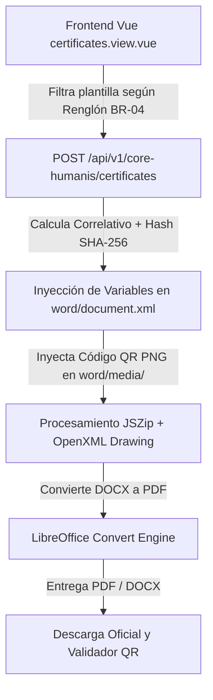

# Catálogo de Plantillas, Formatos Oficiales, Integración con easy-template-x y Normativa Legal BR-04
**Módulo Core Humanis &bull; Secretaría de Comunicación Social de la Presidencia (SCSPR)**

---

## 1. Contexto y Clasificación de la Carpeta `docs/plantillas`

Dentro de la estructura del proyecto en `core-humanis-app/docs/plantillas/` coexisten diversos archivos documentales en formatos `.docx`, `.xlsx` y `.pdf`. Es fundamental aclarar que **no todos los archivos son plantillas dinámicas destinadas a la generación automática de documentos**.

### Tipología de Archivos en `docs/plantillas`:
1. **Plantillas Dinámicas para Generación Automatizada (.docx)**: Documentos Word estructurados con corchetes o etiquetas donde se inyectan variables institucionales mediante el motor de plantillas **`easy-template-x`** y manipulación ZIP/OpenXML (ej. Constancias laborales, constancias de 029/Subgrupo 18).
2. **Formularios e Instrumentos Operativos (.xlsx / .docx)**: Formatos diseñados para llenado manual o control de campo (ej. solicitudes de horas extras, evaluaciones de desempeño, cuestionarios de diagnóstico de capacitación).
3. **Modelos de Actas y Contratos Legales (.docx / .doc)**: Formatos jurídicos que requieren firmas notariadas o trámites específicos ante la Dirección de Recursos Humanos y Contraloría General de Cuentas (ej. Toma de posesión 011/021/022, contratos 029).
4. **Listas de Verificación y Circulares (Checklist PDF / Excel)**: Guías de auditoría de expedientes e instructivos institucionales para pagos e informes de facturación (no se procesan con motor de plantillas).

---

## 2. Marco Normativo Legal: Regla Estricta BR-04 y Contraloría General de Cuentas

La emisión de constancias institucionales en la Secretaría de Comunicación Social de la Presidencia de la República (SCSPR) está supeditada de manera estricta al **régimen jurídico del colaborador**:

### 2.1. Personal en Relación de Dependencia (Renglones 011, 021, 022, 031)
* **Marco Jurídico**: Ley de Servicio Civil y Ley del Salario de Guatenóminas.
* **Características**: Servidores públicos de plantilla con nombramiento o contrato administrativo laboral. Devengan **salario nominal**, se les realizan descuentos de ley (IGSS, Montepío) y gozan de prestaciones laborales (Bono 14, Aguinaldo).
* **Plantilla Aplicable**: **`Plantilla-Constancia-Laboral.docx`** / `Plantilla Constancia Laboral-Ingresos.docx`.
* **Terminología Obligatoria**: "Constancia Laboral", "salario mensual", "puesto nominal", "servidor público".

### 2.2. Prestadores de Servicios Técnicos y Profesionales (Renglones 029, 183, 189)
* **Marco Jurídico**: Ley de Contrataciones del Estado (Decreto No. 57-92 y sus reformas).
* **Características**: Contrataciones administrativas de carácter civil/comercial. **NO existe relación de dependencia ni subordinación laboral**. Perciben **honorarios** (no salario) contra entrega de factura FEL e informe mensual de actividades.
* **Plantilla Aplicable**: **`Plantilla Constancia 029-SG18.docx`** ("Constancia de Prestación de Servicios Técnicos y Profesionales").
* **Prohibición Expresa (Regla BR-04)**: Por auditoría de la Contraloría General de Cuentas (CGC), a estos contratistas **NUNCA** se les puede emitir una "Constancia Laboral" ni emplear palabras como *"salario"*, *"sueldo"*, *"empleado"*, *"trabajador"* o *"jornada"*.

---

## 3. Integración Técnica con `easy-template-x`, Inyección de QR y Conversión a PDF

Para la emisión y automatización de documentos oficiales se combina `easy-template-x`, manipulación directa del paquete OpenXML con `JSZip` y la conversión a PDF sin pérdida de formato mediante **LibreOffice (Headless)**.

### 3.1. Flujo de Generación y Validación Criptográfica:


### 3.2. Convención de Etiquetas y Reemplazos OpenXML:
| Etiqueta Original | Variable / Reemplazo | Descripción / Ejemplo |
| :--- | :--- | :--- |
| `[CORRELATIVO]` / `[No. CORRELATIVO]` | `constancia.correlativo` | Identificador único `SCSPR-URH-CONST-2026-00042` |
| `[AÑO]` | `anioEmisionNum` | Año de emisión `2026` |
| `[NOMBRE COMPLETO]` | `nombreCompleto` | `MARÍA ELENA MORALES PAZ` (En Mayúsculas) |
| `[CUI]` | `colaborador.cui_dpi` | `2345 67890 0101` |
| `[PUESTO NOMINAL]` | `contrato.puesto_nominal` | `ANALISTA DE MONITOREO DE PERSONAL` |
| `[RENGLÓN]` | `contrato.renglon_codigo` | `011` / `029` |
| `[SALARIO EN LETRAS]` | `montoEnLetrasTexto` | `OCHO MIL QUINIENTOS QUETZALES EXACTOS` |
| `[SALARIO EN NÚMEROS]` | `montoFormatted` | `8,500.00` |
| `[No. Acta/Contrato 1]` | `contrato.numero_acuerdo_contrato` | Número de contrato 029 en tabla |
| `[dd/mm/aaaa]` | `fechaInicioStr` / `fechaFinStr` | Fechas de inicio y finalización |
| `` | Imagen PNG `media/qr_validation.png` | Código QR dinámico con URL de validación pública |

---

## 4. Desglose de Plantillas y Formatos por Área Institucional

### 1. Formatos Monitoreo
| Archivo | Apto para Gen. Automatizada | Descripción y Regla de Negocio | Áreas Dependientes |
| :--- | :---: | :--- | :--- |
| **`Plantilla-Constancia-Laboral.docx`** | **SÍ** | Constancia oficial para renglones permanentes y temporales (**011, 021, 022**). Acredita salario y relación de dependencia. | **Monitoreo de Personal** y **Nóminas/Guatenóminas**. |
| **`Plantilla Constancia Laboral-Ingresos.docx`** | **SÍ** | Constancia detallada con desglose de sueldo base, bonificación incentivo y deducciones de ley (**011, 021, 022**). | **Nóminas/Guatenóminas** y **Monitoreo**. |
| **`Plantilla Constancia 029-SG18.docx`** | **SÍ** | Constancia de servicios técnicos/profesionales (**029, 183, 189**). Cumple regla estricta BR-04 (Honorarios, sin relación de dependencia). | **Monitoreo de Personal** y **Contrataciones/Subgrupo 18**. |
| **`Formulario Permiso URH V.01.xlsx`** | NO (Formato Manual) | Solicitud y control de licencias con o sin goce de sueldo. | **Monitoreo de Personal** y **Jefatura Inmediata**. |

---

### 2. Formatos Acciones de Puestos / Contrataciones
| Archivo | Apto para Gen. Automatizada | Descripción | Áreas Dependientes |
| :--- | :---: | :--- | :--- |
| **`PLANTILLA CONTRATO 022.docx`** | **SÍ** | Modelo de contrato administrativo de trabajo bajo renglón 022. | **Contrataciones**, **Presupuesto** y **Asesoría Jurídica**. |
| **`Plantilla Contrato 029.docx`** | **SÍ** | Modelo de contrato de servicios técnicos y profesionales. | **Contrataciones**, **Subgrupo 18** y **DICABI/Cuentas**. |
| **`0. FORMATO 011/021/022 ACTA TOMA POSESION.doc`** | **SÍ** | Acta formal de inicio de labores en el puesto. | **Monitoreo de Personal** y **Jefatura de Unidad**. |
| **`0. FORMATO 011/021/022 ACTA ENTREGA.docx`** | **SÍ** | Acta de entrega de puesto por suspensión, traslado o baja. | **Monitoreo de Personal** e **Inventarios/Auditoría**. |
| **`Requisicion Personal Renglon 011/021/022 SCSP.xlsx`** | NO (Excel Operativo) | Formato de solicitud de plazas y creación de vacantes. | **Planificación/Organización** y **Presupuesto**. |
| **`Requisicion Servicios Renglon 029-Subgrupo18 SCSP.xlsx`** | NO (Excel Operativo) | Solicitud de contratación de servicios técnicos. | **Unidad Solicitante** y **Subgrupo 18**. |

---

### 3. Formatos Desarrollo
| Archivo | Apto para Gen. Automatizada | Descripción | Áreas Dependientes |
| :--- | :---: | :--- | :--- |
| **`F-03 Formato Evaluacion del Desempeño.xlsx`** | NO (Evaluación) | Matriz de evaluación semestral/anual de desempeño. | **Desarrollo Institucional** y **Jefaturas**. |
| **`F-02 Cuestionario Diagnostico Necesidades.docx`** | NO (Cuestionario) | Instrumento DNC para detectar vacíos de capacitación. | **Desarrollo Institucional**. |
| **`CONSTANCIA DE CODIGO DE ETICA.docx`** | **SÍ** | Carta firmada por el colaborador de recibida del Código de Ética. | **Desarrollo Institucional** y **Talento Humano**. |
| **`CONSTANCIA DE ACOSO SEXUAL Y LABORAL.docx`** | **SÍ** | Compromiso de cero tolerancia al acoso institucional. | **Desarrollo Institucional** y **Auditoría Interna**. |
| **`F-07 Reporte Accidente o Incidente Laboral.docx`** | NO (Formato Incidente) | Formulario de notificación de accidentes laborales e IGSS. | **Desarrollo Institucional** y **Salud Ocupacional**. |

---

### 4. Formatos Horas Extra
| Archivo | Apto para Gen. Automatizada | Descripción | Áreas Dependientes |
| :--- | :---: | :--- | :--- |
| **`3. FORMATO DE OFICIO PARA SOLICITUD DE HORAS EXTRAS.docx`** | **SÍ** | Oficio formal dirigido a URH para autorización de turnos extraordinarios. | **Unidad Requiriere** y **Monitoreo de Personal**. |
| **`2. FORMATO REPORTE CONTROL DE HORAS EXTRAS.xlsx`** | NO (Control Asistencia) | Bitácora de marcado y cálculo de horas de tiempo extraordinario. | **Monitoreo de Personal** y **Nóminas**. |
| **`Formato Asignacion Turnos SCSP (Vert/Horiz).docx`** | **SÍ** | Programación de turnos del personal operativo y de comunicación. | **Monitoreo de Personal**. |

---

### 5. Formatos 029 & Subgrupo 18
| Archivo | Apto para Gen. Automatizada | Descripción | Áreas Dependientes |
| :--- | :---: | :--- | :--- |
| **`Formato Informe Mensual.docx`** / **`Formato Informe Final.docx`** | **SÍ** | Formato estandarizado de reporte de actividades del prestador de servicios. | **Prestador de Servicios** y **Supervisor del Contrato**. |
| **`FINIQUITO MODELO 029.docx`** | **SÍ** | Finiquito legal al culminar o rescindir contrato 029. | **Subgrupo 18**, **Jurídico** y **Financiero**. |
| **`ACTA NOTARIAL DE DECLARACION JURADA 029.docx`** | **SÍ** | Declaración jurada de no tener impedimento legal para contratar con el Estado. | **Contrataciones** y **Notaría**. |

---

### 6. Formatos Check List (Archivos PDF)
| Archivo | Tipo | Descripción |
| :--- | :---: | :--- |
| `CHECK LIST 2026-scspr - 029 CORREGIDO CON INVENTARIO DE CUENTAS.pdf` | Auditoría | Verificación de requisitos legales para expedientes de servicios 029. |
| `CHECK LIST 2026-scspr - 021,011,022 CON INVENTARIO DE CUENTAS 1.pdf` | Auditoría | Verificación de expedientes para personal de plantilla presupuestaria. |

---

## 5. Implementación en Código Node.js con `JSZip`, `easy-template-x` e Inyección de QR

A continuación se detalla la función principal del servicio backend (`api/src/services/certificates.service.js`) que ejecuta la inyección del QR y reemplazo seguro de comodines en las plantillas oficiales de la SCSPR:

```javascript
const fs = require("fs");
const path = require("path");
const JSZip = require("jszip");
const QRCode = require("qrcode");
const libre = require("libreoffice-convert");
const util = require("util");
const libreConvertAsync = util.promisify(libre.convert);

/**
 * Genera el archivo PDF o Word (.docx) oficial inyectando datos en la plantilla Word real de la SCSPR
 */
async function generarConstanciaOficialFile(constancia, contrato, colaborador, format = "pdf") {
  // Regla Legal Estricta BR-04 / Contraloría General de Cuentas (SCSPR):
  // Renglones 011, 021, 022, 031 (Relación de Dependencia / Guatenóminas) -> Plantilla-Constancia-Laboral.docx
  // Renglones 029, 183, 189 (Servicios Técnicos y Profesionales / Sin Relación Laboral) -> Plantilla Constancia 029-SG18.docx
  const renglon = (contrato.renglon_codigo || "011").toString().trim();
  const isLaboral = ["011", "021", "022", "031"].includes(renglon);
  const fileNames = isLaboral
    ? ["Plantilla-Constancia-Laboral.docx", "Plantilla Constancia Laboral.docx"]
    : ["Plantilla Constancia 029-SG18.docx", "Plantilla-Constancia-029-SG18.docx"];

  const posiblesRutas = [];
  for (const fn of fileNames) {
    posiblesRutas.push(path.join("/usr/src/app/plantillas/Formatos Monitoreo", fn));
    posiblesRutas.push(path.join(__dirname, "../../../core-humanis-app/docs/plantillas/Formatos Monitoreo", fn));
  }

  const templatePath = posiblesRutas.find((p) => fs.existsSync(p));
  if (!templatePath) {
    throw new Error(`No se encontró el archivo de plantilla oficial para ${isLaboral ? 'Laboral' : '029'}`);
  }

  const fileBuffer = fs.readFileSync(templatePath);
  const zip = await JSZip.loadAsync(fileBuffer);

  let documentXml = await zip.file("word/document.xml").async("string");
  documentXml = documentXml.replace(/<w:proofErr[^>]*\/>/g, "");

  const nombreCompleto = `${colaborador.primer_nombre} ${colaborador.segundo_nombre || ""} ${colaborador.primer_apellido} ${colaborador.segundo_apellido || ""}`.replace(/\s+/g, " ").trim().toUpperCase();
  const esFemenino = (colaborador.genero || "").toLowerCase().startsWith("f");

  const fechaInicioObj = new Date(contrato.fecha_inicio || Date.now());
  const diaInicioNum = fechaInicioObj.getDate();
  const mesInicioTexto = fechaInicioObj.toLocaleDateString("es-GT", { month: "long" });
  const anioInicioNum = fechaInicioObj.getFullYear();

  const fechaEmisionObj = new Date(constancia.created_at || Date.now());
  const diaEmisionNum = fechaEmisionObj.getDate();
  const mesEmisionTexto = fechaEmisionObj.toLocaleDateString("es-GT", { month: "long" });
  const anioEmisionNum = fechaEmisionObj.getFullYear();

  const montoVal = Number(contrato.salario_honorarios || 0);
  const montoFormatted = montoVal.toLocaleString("es-GT", { minimumFractionDigits: 2 });
  const montoEnLetrasTexto = `${numeroALetras(montoVal).toUpperCase()} QUETZALES EXACTOS`;

  if (isLaboral) {
    // Reemplazos para Plantilla Constancia Laboral.docx (011, 021, 022)
    documentXml = documentXml
      .replace(/\[CORRELATIVO\]/g, constancia.correlativo || "SCSPR-URH-CONST-2026-00001")
      .replace(/\[AÑO\]/g, String(anioEmisionNum))
      .replace(/\[señor\/señora\]/g, esFemenino ? "señora" : "señor")
      .replace(/\[El\/La\]/g, esFemenino ? "La" : "El")
      .replace(/\[señor\/señora\/Licenciado\/Licenciada\]/g, esFemenino ? "señora" : "señor")
      .replace(/\[NOMBRE COMPLETO\]/g, nombreCompleto)
      .replace(/\[CUI\]/g, colaborador.cui_dpi || "2345 67890 0101")
      .replace(/\[PUESTO NOMINAL\]/g, (contrato.puesto_nominal || contrato.puesto_funcional || "COLABORADOR").toUpperCase())
      .replace(/\[RENGLÓN\]/g, contrato.renglon_codigo || "011")
      .replace(/\[NOMBRE DEL RENGLÓN\]/g, (contrato.renglon_nombre || "PERSONAL PERMANENTE").toUpperCase())
      .replace(/\[SALARIO EN LETRAS\]/g, montoEnLetrasTexto)
      .replace(/\[SALARIO EN NÚMEROS\]/g, montoFormatted);
  } else {
    // Reemplazos para Plantilla Constancia 029-SG18.docx (029)
    const fechaFinObj = new Date(contrato.fecha_fin || `${anioEmisionNum}-12-31`);
    const diaFinNum = fechaFinObj.getDate();
    const mesFinTexto = fechaFinObj.toLocaleDateString("es-GT", { month: "long" });
    const anioFinNum = fechaFinObj.getFullYear();

    const fInicioStr = `${String(diaInicioNum).padStart(2, "0")}/${String(fechaInicioObj.getMonth() + 1).padStart(2, "0")}/${anioInicioNum}`;

    documentXml = documentXml
      .replace(/\[No\. CORRELATIVO\]/g, constancia.correlativo || "SCSPR-URH-CONST-2026-00001")
      .replace(/\[CORRELATIVO\]/g, constancia.correlativo || "SCSPR-URH-CONST-2026-00001")
      .replace(/\[AÑO\]/g, String(anioEmisionNum))
      .replace(/\[INICIALES\]/g, "IR-jpcp")
      .replace(/\[el\/la\]/g, esFemenino ? "la" : "el")
      .replace(/\[licenciado\(a\)\/señor\(a\)\]/g, esFemenino ? "señora" : "señor")
      .replace(/\[NOMBRE COMPLETO\]/g, nombreCompleto)
      .replace(/\[CUI\]/g, colaborador.cui_dpi || "2345 67890 0101")
      .replace(/\[No\. Acta\/Contrato 1\]/g, contrato.numero_acuerdo_contrato || "029-001-2026")
      .replace(/\[dd\/mm\/aaaa\]/g, fInicioStr)
      .replace(/\[No\. de pagos\]/g, "12")
      .replace(/\[monto\]/g, montoFormatted)
      .replace(/\[Renglón\]/g, contrato.renglon_codigo || "029")
      .replace(/\[número\]/g, "una (1)")
      .replace(/\[día en letras\]/g, numeroALetras(diaEmisionNum))
      .replace(/\[dd\]/g, String(diaEmisionNum))
      .replace(/\[mes en letras\]/g, mesEmisionTexto)
      .replace(/\[mm\]/g, String(fechaEmisionObj.getMonth() + 1).padStart(2, "0"))
      .replace(/\[año en letras\]/g, numeroALetras(anioEmisionNum))
      .replace(/\[aaaa\]/g, String(anioEmisionNum));
  }

  // Generar e insertar código QR oficial de validación en la estructura Word (.docx)
  try {
    const qrBuffer = await QRCode.toBuffer(
      `https://rrhh.scspr.gob.gt/core-humanis/validar/${constancia.hash_verificacion || "validar"}`,
      { width: 140, margin: 1 }
    );
    zip.file("word/media/qr_validation.png", qrBuffer);

    let rels = await zip.file("word/_rels/document.xml.rels").async("string");
    if (!rels.includes("rIdQRVal")) {
      rels = rels.replace("</Relationships>", `<Relationship Id="rIdQRVal" Type="http://schemas.openxmlformats.org/officeDocument/2006/relationships/image" Target="media/qr_validation.png"/></Relationships>`);
      zip.file("word/_rels/document.xml.rels", rels);
    }

    let contentTypes = await zip.file("[Content_Types].xml").async("string");
    if (!contentTypes.includes('Extension="png"')) {
      contentTypes = contentTypes.replace("</Types>", `<Default Extension="png" ContentType="image/png"/></Types>`);
      zip.file("[Content_Types].xml", contentTypes);
    }

    const qrXml = `
      <w:p>
        <w:pPr><w:jc w:val="center"/></w:pPr>
        <w:r>
          <w:drawing>
            <wp:inline distT="0" distB="0" distL="0" distR="0" xmlns:wp="http://schemas.openxmlformats.org/drawingml/2006/wordprocessingDrawing">
              <wp:extent cx="950000" cy="950000"/>
              <wp:docPr id="999" name="QR Code"/>
              <a:graphic xmlns:a="http://schemas.openxmlformats.org/drawingml/2006/main">
                <a:graphicData uri="http://schemas.openxmlformats.org/drawingml/2006/image">
                  <pic:pic xmlns:pic="http://schemas.openxmlformats.org/drawingml/2006/picture">
                    <pic:nvPicPr><pic:cNvPr id="999" name="qr.png"/><pic:cNvPicPr/></pic:nvPicPr>
                    <pic:blipFill><a:blip r:embed="rIdQRVal" xmlns:r="http://schemas.openxmlformats.org/officeDocument/2006/relationships"/><a:stretch><a:fillRect/></a:stretch></pic:blipFill>
                    <pic:spPr><a:xfrm><a:off x="0" y="0"/><a:ext cx="950000" cy="950000"/></a:xfrm><a:prstGeom prst="rect"><a:avLst/></a:prstGeom></pic:spPr>
                  </pic:pic>
                </a:graphicData>
              </a:graphic>
            </wp:inline>
          </w:drawing>
        </w:r>
      </w:p>
    `;
    documentXml = documentXml.replace("</w:body>", qrXml + "</w:body>");
  } catch (errQR) {
    console.warn("⚠️ No se pudo inyectar el código QR en la plantilla:", errQR.message);
  }

  zip.file("word/document.xml", documentXml);
  const docxBuffer = await zip.generateAsync({ type: "nodebuffer" });

  if (format === "docx") {
    return {
      buffer: docxBuffer,
      contentType: "application/vnd.openxmlformats-officedocument.wordprocessingml.document",
      extension: "docx",
    };
  }

  // Convertir a PDF preservando membretes y logos oficiales con LibreOffice
  const pdfBuffer = await libreConvertAsync(docxBuffer, ".pdf", undefined);
  return {
    buffer: pdfBuffer,
    contentType: "application/pdf",
    extension: "pdf",
  };
}

module.exports = { generarConstanciaOficialFile };
```

---

## 6. Conclusión y Lineamientos de Mantenimiento

1. **Cumplimiento de Auditoría Interna y CGC**: La regla de separación entre Renglón 011/021/022 (Constancia Laboral) y Renglón 029/Subgrupo 18 (Constancia de Servicios) debe ser respetada en todo momento tanto en el frontend (`certificates.view.vue`) como en la API backend.
2. **Preservación del Membrete Oficial**: Los archivos en `docs/plantillas/Formatos Monitoreo/` son la fuente oficial de diseño Hi-Fi de la SCSPR. No deben reemplazarse por documentos planos sin logos.
3. **Pista de Auditoría y Verificación**: Cada documento emitido guarda su Hash SHA-256 en PostgreSQL (`constancias_emitidas`) y genera un código QR que permite a terceros consultar la autenticidad pública del documento.
