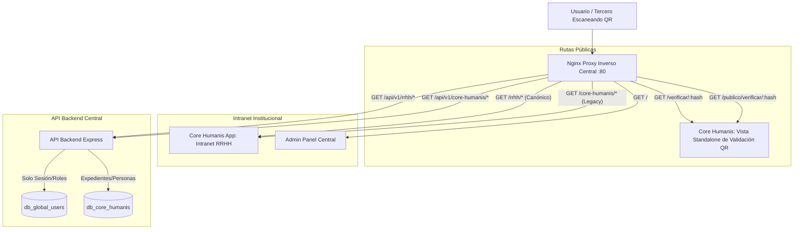

# Arquitectura de Rutas Públicas, Validación QR y Desacoplamiento de Autenticación
**Módulo Core Humanis (Recursos Humanos) &bull; Secretaría de Comunicación Social de la Presidencia (SCSPR)**

---

## 1. Visión General y Principios de Diseño

Este documento especifica la arquitectura de enrutamiento, separación de dominios y ciclo de vida de URLs implementadas en el módulo de Recursos Humanos (**Core Humanis**) tras la auditoría técnica de arquitectura:

1. **Separación Estricta de Dominios (SRP - Single Responsibility Principle)**:
   - El **Servicio de Autenticación (`/auth`)** gestiona única y exclusivamente sesiones, tokens JWT, roles y permisos de acceso. **No almacena, consulta ni muta datos del expediente de colaboradores (`personas`)**.
   - El **Módulo de Recursos Humanos (`/portal` / `/collaborators`)** es el dueño legítimo de los expedientes personales, puestos funcionales, contratos, relaciones laborales y saldos de vacaciones.

2. **Aislamiento de Rutas Privadas vs Enlaces Públicos (Verificación QR)**:
   - **Intranet Privada (`/rrhh`)**: Acceso exclusivo para servidores públicos y personal de RRHH autenticado.
   - **Portal Público de Validación (`/verificar/:hash`)**: URL limpia de primer nivel para validación ciudadana y de terceros (bancos, embajadas, Contraloría General de Cuentas, juzgados), sin barra de navegación interna ni requerimiento de credenciales.

---

## 2. Mapa de Enrutamiento y Arquitectura Nginx



---

## 3. Desacoplamiento: Autenticación (`/auth`) vs Expediente RRHH (`/portal`)

### 3.1. Servicio de Autenticación (`/auth/me`)
* **Propósito**: Verificar la validez de la sesión JWT y proveer la identidad y control de acceso.
* **Comportamiento**: No realiza consultas a la base de datos de RRHH (`personas`).
* **Respuesta Canónica**:
```json
{
  "success": true,
  "user": {
    "id": "usr-uuid-1234",
    "username": "mmorales",
    "email": "mmorales@scspr.gob.gt",
    "name": "Maria Morales",
    "role": "COLABORADOR",
    "rol_nombre": "Colaborador Institucional (Self-Service)",
    "permissions": ["core-humanis:read"]
  },
  "_links": {
    "self": { "href": "/api/v1/core-humanis/auth/me", "method": "GET" },
    "portalProfile": { "href": "/api/v1/core-humanis/portal/profile", "method": "GET" }
  }
}
```

### 3.2. Expediente del Colaborador en RRHH (`/portal/profile` o `/portal/me`)
* **Propósito**: Resolver el expediente laboral completo en el módulo de Recursos Humanos mediante el Código Único de Identificación (CUI) o correo electrónico.
* **Comportamiento**: Consulta PostgreSQL `core_humanis` (`personas`, `relaciones_laborales`, `renglones_presupuestarios`, `puestos_funcionales`).
* **Respuesta Canónica**:
```json
{
  "success": true,
  "profile": {
    "id": "usr-uuid-1234",
    "persona_id": "pers-uuid-9876",
    "cui_dpi": "1984567290101",
    "nombres": "María",
    "apellidos": "Morales Gómez",
    "puesto_funcional": "Analista de Comunicación",
    "unidad_admin": "Dirección de Comunicación Digital",
    "renglon_codigo": "011",
    "telefono_personal": "5551-0101",
    "correo_personal": "maria.morales@correo.com",
    "direccion_residencia": "Ciudad de Guatemala",
    "departamento": "Guatemala",
    "municipio": "Guatemala"
  },
  "_links": {
    "self": { "href": "/api/v1/core-humanis/portal/profile", "method": "GET" },
    "updateProfile": { "href": "/api/v1/core-humanis/portal/profile", "method": "PUT" },
    "downloadProfile": { "href": "/api/v1/core-humanis/portal/profile/download", "method": "GET" }
  }
}
```

---

## 4. Rutas Públicas de Validación QR (`/verificar/:hash`)

### 4.1. Justificación y Optimización de Densidad QR
Cuando un colaborador emite una Constancia Laboral (011/022) o de Prestación de Servicios (029/18), el sistema genera un sello criptográfico y un código QR al pie de página:

* **URL Anterior (Deprecada)**:
  `https://rrhh.scspr.gob.gt/certificates/verifications/a8f9c2e0b...` (~95 caracteres)
  * *Problema*: Exceso de caracteres que genera una matriz QR muy densa (versión 6-7, >40x40 módulos), difícil de enfocar con celulares económicos o impresiones físicas estándar.
* **URL Actual (Canónica)**:
  `https://rrhh.scspr.gob.gt/verificar/a8f9c2e0b...` (~65 caracteres)
  * *Ventaja*: QR de menor densidad (versión 4, 33x33 módulos), escaneo instantáneo, URL limpia y representativa de servicio público.

### 4.2. Aislamiento de la Interfaz Visual en Frontend
En `core-humanis-app/src/App.vue`, se implementó la detección de rutas públicas mediante `isPublicRoute`:
* Si la ruta activa es `/verificar/:hash` o `/publico/verificar/:hash`:
  * Se renderiza **exclusivamente la vista oficial del validador** (`CertificateVerificationView`).
  * Se **ocultan completamente** la barra lateral de navegación (`AppSidebar`) y la cabecera interna (`AppHeader`).
  * El visitante externo solo visualiza el escudo oficial de Guatemala, los datos de autenticidad del documento y el botón de retorno al portal institucional.

### 4.3. Manejo de Errores e Interceptores HTTP
En `core-humanis-app/src/api/client.js`:
* Las rutas que contengan `/verificar` o `/validar` quedan exentas de la regla de redirección automática hacia `/login` ante códigos de respuesta `401 Unauthorized`.
* Esto garantiza que usuarios no autenticados puedan consultar constancias sin ser forzados a iniciar sesión.

---

## 5. Matriz Canónica de URLs y Redirecciones

| Contexto | Ruta Frontend / URL Externa | Endpoint API Backend | Nivel de Acceso | Descripción |
| :--- | :--- | :--- | :--- | :--- |
| **Intranet** | `/rrhh/` | `/api/v1/rrhh/*` | Privado (`JWT`) | Acceso principal al módulo de Recursos Humanos |
| **Intranet (Alias)** | `/core-humanis/` | `/api/v1/core-humanis/*` | Privado (`JWT`) | Alias legacy para compatibilidad retroactiva |
| **Público (QR)** | `/verificar/:hash` | `/api/v1/core-humanis/verificar/:hash` | **Público Libre** | Validador ciudadano de constancias y firmas |
| **Público (Alias 1)** | `/publico/verificar/:hash` | `/api/v1/core-humanis/publico/verificar/:hash` | **Público Libre** | Redirección amigable a `/verificar/:hash` |
| **Público (Alias 2)** | `/validar/:hash` | `/api/v1/core-humanis/constancias/verificar/:hash`| **Público Libre** | Redirección legacy hacia `/verificar/:hash` |
| **Público (Legacy)** | `/certificates/verifications/:hash` | `/api/v1/core-humanis/certificates/verifications/:hash` | **Público Libre** | Soporte de constancias impresas históricas |
| **Autenticación** | N/A (Consumo API) | `GET /api/v1/core-humanis/auth/me` | Privado (`JWT`) | Consulta estricta de sesión, roles y permisos |
| **Expediente RRHH** | `/rrhh/portal` | `GET /api/v1/core-humanis/portal/profile` | Privado (`JWT`) | Ficha 360° del colaborador autenticado |

---

## 6. Enlaces Hipermedia HATEOAS Estandarizados

En `api/src/utils/hateoas.helper.js`, los objetos de respuesta incluyen metadatos de navegación semántica:

```javascript
// Enlace generado al emitir una constancia oficial
{
  "self": {
    "href": "/api/v1/core-humanis/certificates/CONST-2026-0042",
    "method": "GET"
  },
  "verification": {
    "href": "/api/v1/core-humanis/certificates/verifications/a8f9c2e0b1d3",
    "method": "GET",
    "description": "Endpoint público de validación institucional QR (sin autenticación)"
  },
  "publicValidationPage": {
    "href": "/verificar/a8f9c2e0b1d3",
    "method": "GET",
    "description": "Portal web público de validación ciudadana con sello institucional"
  }
}
```
