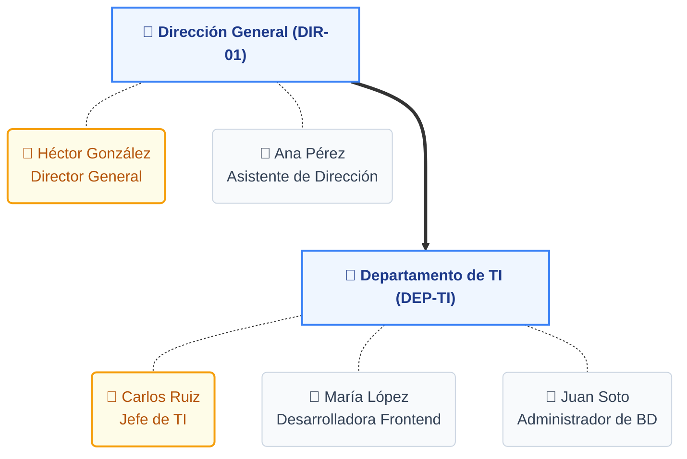

# Manual de Carga de Organigramas (Archivo CSV)

Este documento describe el procedimiento para la carga manual de organigramas y estructura ocupacional en el sistema, a través de la funcionalidad de "Drop Zone" en la vista de Organigramas.

## 1. Introducción

El sistema permite previsualizar o sobreescribir temporalmente la estructura jerárquica de la institución cargando un archivo `.csv` (valores separados por comas). 
Esto es útil para visualizar propuestas de reestructuración, pruebas o cuando se desea renderizar una jerarquía específica sin alterar la base de datos oficial.

La estructura oficial de Core Humanis se basa en **Unidades Administrativas**, donde cada unidad agrupa a un conjunto de colaboradores, clasificándolos automáticamente en **Jefaturas (Nivel 1)** o **Subordinados/Equipo Técnico (Nivel 2)** dependiendo del puesto. Además, una unidad puede tener unidades subordinadas (subunidades), generando un árbol institucional jerárquico.

## 2. Formato del Archivo CSV

El archivo debe tener formato de texto plano (`.csv` o `.txt`) y debe cumplir estrictamente con el siguiente orden de columnas (separadas por coma):

```csv
cod_unidad, nombre_unidad, cod_padre, cod_empleado, nombre_empleado, puesto
```

### Descripción de las columnas:

1. **`cod_unidad`** *(Obligatorio)*: El código único de la unidad administrativa a la que pertenece el empleado (Ej. `DIR-01`, `DEP-01`, `1001`).
2. **`nombre_unidad`** *(Obligatorio)*: El nombre de la unidad administrativa (Ej. `Dirección General`, `Departamento de TI`).
3. **`cod_padre`** *(Opcional)*: El `cod_unidad` de la unidad superior de la que depende jerárquicamente esta unidad. Si la unidad es la raíz principal de la institución, este campo se deja en blanco.
4. **`cod_empleado`** *(Opcional)*: El identificador único, CUI o código del empleado asignado a esta unidad.
5. **`nombre_empleado`** *(Opcional)*: El nombre completo del colaborador.
6. **`puesto`** *(Opcional)*: El puesto nominal o funcional del colaborador (Ej. `Director Administrativo`, `Analista de Sistemas`).

*Nota:* Si solo deseas dibujar la estructura de las unidades sin asignar personal a una unidad, puedes dejar vacías las columnas 4, 5 y 6, manteniendo las comas correspondientes:
`cod_unidad, nombre_unidad, cod_padre,,,`

## 3. Ejemplo Práctico de Archivo

A continuación, se muestra cómo debería verse el contenido del archivo `.csv` para crear una pequeña estructura con una Dirección General y un Departamento de TI dependiente de ella:

```csv
cod_unidad, nombre_unidad, cod_padre, cod_empleado, nombre_empleado, puesto
DIR-01, Dirección General,, 101, Héctor González, Director General
DIR-01, Dirección General,, 102, Ana Pérez, Asistente de Dirección
DEP-TI, Departamento de TI, DIR-01, 201, Carlos Ruiz, Jefe de TI
DEP-TI, Departamento de TI, DIR-01, 202, María López, Desarrolladora Frontend
DEP-TI, Departamento de TI, DIR-01, 203, Juan Soto, Administrador de Base de Datos
```

### ¿Cómo lo interpretará el sistema?

Visualmente, el sistema construirá la siguiente jerarquía:



- **Unidad: Dirección General (DIR-01)**
  - Es el nodo raíz (no tiene `cod_padre`).
  - **Jefatura (Nivel 1):** Héctor González (porque su puesto contiene la palabra clave "Director").
  - **Subordinados (Nivel 2):** Ana Pérez.
  - **Subunidades:** Departamento de TI (DEP-TI).

- **Unidad: Departamento de TI (DEP-TI)**
  - Depende jerárquicamente de `DIR-01`.
  - **Jefatura (Nivel 1):** Carlos Ruiz (porque su puesto contiene la palabra clave "Jefe").
  - **Subordinados (Nivel 2):** María López, Juan Soto.

## 4. Clasificación Automática (Nivel 1 vs Nivel 2)

El sistema lee automáticamente el texto que introduces en la columna `puesto` y lo clasifica dentro de la unidad de la siguiente forma:

- **Se clasificará como Jefatura (Nivel 1)** si el texto del puesto contiene alguna de estas palabras clave (sin importar mayúsculas o minúsculas):
  - `jefe`
  - `director`
  - `secretario` o `secretaria`
  - `encargado`
  
- **Se clasificará como Equipo Técnico / Subordinado (Nivel 2)** en cualquier otro caso (Ej. `Analista`, `Desarrollador`, `Asesor`, `Colaborador`).

## 5. Instrucciones de Uso (UI/UX)

1. Ingresa a la pantalla de **Organigramas**.
2. Ubica la caja superior con el texto **"Haz clic o arrastra un archivo CSV"**.
3. Arrastra tu archivo `.csv` dentro de la zona delineada (o haz clic para abrir el explorador de archivos).
4. El sistema verificará el archivo y mostrará una notificación verde si fue cargado correctamente.
5. El árbol jerárquico inferior se redibujará inmediatamente mostrando los datos de tu archivo.
6. Si deseas regresar a la estructura oficial de la Base de Datos, haz clic en el botón **"✕ Restablecer"**.

## 6. Datos Faltantes (Limitaciones vs Base de Datos Oficial)

Dado que la carga manual mediante CSV está diseñada como una herramienta rápida de simulación y ajuste, la estructura generada visualmente omite ciertos datos complejos que sí existen en la base de datos oficial (PostgreSQL):

1. **Renglón Presupuestario:** El archivo CSV simplificado no contempla el renglón (ej. 011, 022, 029). Por defecto, en la previsualización se asignará el símbolo `-` para este campo.
2. **Documento de Identificación (CUI/DPI):** No hay una columna dedicada al CUI. El sistema reutiliza temporalmente el valor de `cod_empleado` en el espacio destinado para el DPI del empleado.
3. **Puestos Nominales vs Funcionales:** La base de datos oficial diferencia estrictamente entre el puesto nominal (el registrado en Recursos Humanos) y el puesto funcional (las funciones reales que ejerce). En el CSV, ambos conceptos se consolidan en la única columna `puesto`.
4. **Fotografías de Perfil (`foto_url`):** La carga de CSV no enlaza las fotografías de perfil de los empleados (se mostrará el avatar por defecto con las iniciales).
5. **Estado Contractual:** El organigrama de la base de datos filtra automáticamente para mostrar solo a los empleados con contrato vigente (`es_contrato_actual = true`). Al usar el archivo CSV, el sistema asumirá que todos los individuos declarados en el archivo se encuentran con contrato activo en esa unidad.
