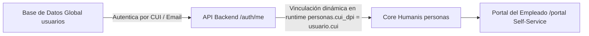

# Portal del Empleado (Self-Service) & Amarre Desacoplado de Usuarios por CUI/DPI
**Módulo Core Humanis &bull; Secretaría de Comunicación Social de la Presidencia (SCSPR)**

---

## 1. Alcance y Arquitectura de Autenticación Desacoplada

El **Portal del Empleado (Self-Service)** habilita a los colaboradores de la SCSPR para autogestionar su información laboral, solicitar vacaciones, permisos y emitir constancias digitales con código QR de forma autónoma.

### Principio de Arquitectura de Base de Datos:
> **Regla de Oro**: Para evitar modificar las estructuras de la base de datos central/global (`db_global_users`) ni alterar tablas compartidas por otros submódulos de la institución, el expediente del colaborador (`personas`) se vincula en tiempo de ejecución con la cuenta de usuario (`usuarios`) mediante el **Código Único de Identificación (CUI / DPI)** o **Correo Institucional / Personal**.



---

## 2. Definición del Rol `COLABORADOR`

### Permisos y Capacidades:
- **Lectura Única de su Expediente**: Acceso exclusivo a sus propios datos personales, nombramiento vigente, historial de puestos y constancias emitidas.
- **Autogestión de Datos de Contacto**: Solicitud de actualización de teléfono personal, correo alternativo, dirección de residencia y contacto de emergencia.
- **Trámites de Control de Tiempo**:
  - Consulta de saldos de vacaciones acumulados/disponibles.
  - Creación de solicitudes de **Vacaciones** y **Licencias/Permisos**.
- **Generación de Constancias con Validación QR**:
  - Descarga e impresión autónoma de Constancias Laborales oficiales (011/022) o de Prestación de Servicios (029/Subgrupo 18) validadas criptográficamente.
- **Asistencia y Puntualidad**: Consulta de marcajes de entrada/salida del mes.

### Restricciones del Rol `COLABORADOR`:
- 🚫 **No puede** ver ni consultar expedientes de otros colaboradores del directorio.
- 🚫 **No puede** modificar su salario, renglón presupuestario o puesto funcional.
- 🚫 **No puede** aprobar sus propias solicitudes de vacaciones o licencias.

---

## 3. Flujo de Habilitación de Acceso y Gestión por Recursos Humanos

### 3.1. Habilitación de Acceso desde la Ficha 360°
Cualquier analista o jefe de Recursos Humanos con permisos `core-humanis:write` puede gestionar la cuenta de un colaborador desde la Ficha del Colaborador (`/collaborators/:id`):

1. **Paso 1**: Hacer clic en el botón **`🔑 Acceso Portal Self-Service`** en la barra superior de acciones.
2. **Paso 2**: El modal de gestión muestra:
   - Identificador único de usuario (CUI / DPI).
   - Correo institucional/personal para notificaciones.
   - Rol predeterminado: `COLABORADOR (Self-Service)`.
3. **Paso 3**: Opción de copiar los datos de acceso predeterminados al portapapeles para notificar al empleado.

### 3.2. Sincronización Automática en `/auth/me`
Cuando un colaborador ingresa credenciales válidas en `/login`:
1. El backend firma el JWT incluyendo el `userId`, `email`, `cui` y `role`.
2. Al consultar `GET /api/v1/core-humanis/auth/me`, la API realiza un `JOIN` dinámico:
   ```sql
   SELECT p.*, rl.salario_honorarios, rp.codigo as renglon_codigo, pf.nombre as puesto_funcional, ua.nombre as unidad_admin
   FROM personas p
   LEFT JOIN relaciones_laborales rl ON rl.persona_id = p.id AND rl.es_contrato_actual = true
   LEFT JOIN renglones_presupuestarios rp ON rl.renglon_id = rp.id
   LEFT JOIN puestos_funcionales pf ON rl.puesto_funcional_id = pf.id
   LEFT JOIN unidades_administrativas ua ON rl.unidad_admin_id = ua.id
   WHERE REPLACE(p.cui_dpi, ' ', '') = $1 OR LOWER(p.correo_institucional) = $2
   ```
3. El frontend recibe la propiedad `user.persona` y redirige automáticamente al portal `/portal`.

---

## 4. Estructura de Pantallas del Portal Self-Service (`/portal`)

```
+-----------------------------------------------------------------------------+
|  [ 🇬🇹 SCSPR ] Bienvenido(a), MARIA MORALES        [Solicitar Vacaciones]   |
|  Portal Self-Service • Analista de Comunicación    [Solicitar Licencia]     |
+-----------------------------------------------------------------------------+
| (Tablero) | (Mi Expediente) | (Solicitudes) | (Asistencia) | (Constancias)  |
+-----------------------------------------------------------------------------+
|                                                                             |
|  +-----------------------+  +----------------------+  +------------------+  |
|  | DÍAS DERECHO (LEY)    |  | DÍAS UTILIZADOS      |  | DÍAS DISPONIBLES |  |
|  | 15 Días               |  | 0 Días               |  | 15 Días          |  |
|  +-----------------------+  +----------------------+  +------------------+  |
|                                                                             |
|  • Mi Nombramiento Vigente: Analista de Comunicación (Renglón 011)          |
|  • Semáforo de Expediente: Completo 🟢                                      |
|  • Mis Constancias Emitidas con QR (Descarga directa en PDF)               |
+-----------------------------------------------------------------------------+
```

---

## 5. Matriz de Reglas de Negocio Aplicables

| Código Regla | Descripción | Componente / Servicio |
| :--- | :--- | :--- |
| **BR-01** | **Identificación Única por CUI**: Todo expediente de colaborador y cuenta de acceso debe amarrarse mediante los 13 dígitos del CUI/DPI. | `personas.cui_dpi`, `/auth/me` |
| **BR-02** | **Aislamiento de BD Global**: La vinculación usuario-persona ocurre en tiempo de ejecución de la API sin crear campos o llaves foráneas en `db_global_users`. | `core-humanis-auth.controller.js` |
| **BR-04** | **Restricción de Constancias por Renglón**: Para colaboradores 029/18 se emiten constancias de "Servicios Técnicos" sin mencionar términos salariales ni laborales. | `certificates.service.js` |
| **BR-05** | **Autorización de Trámites**: Las solicitudes de vacaciones/permisos creadas en el portal quedan en estado `PENDIENTE` hasta ser firmadas por la Jefatura/RRHH. | `portal.view.vue`, `vacations.store.js` |
