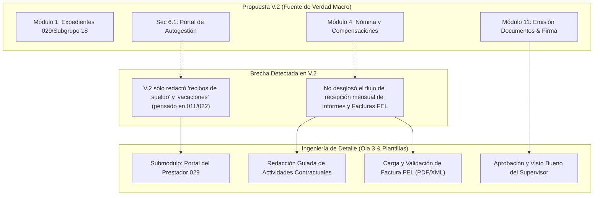
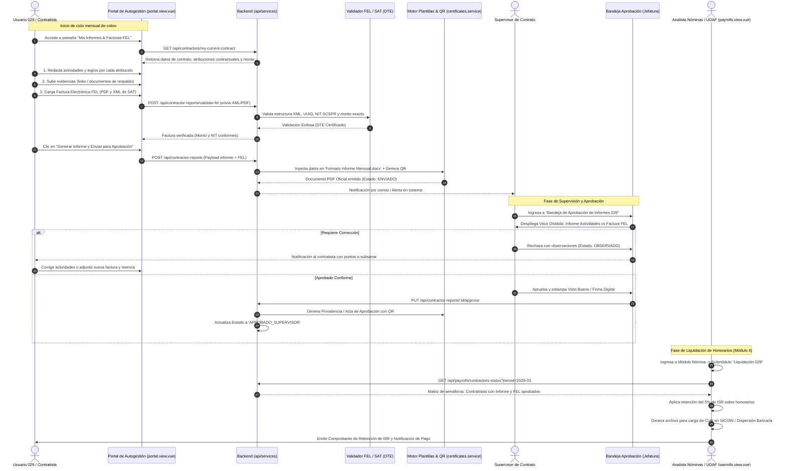

# Validación y Alineación: Informes de Actividades y Facturas FEL vs. Propuesta Plataforma RRHH SCSPR V.2

**Fecha de Análisis:** Octubre 2026  
**Documento Fuente de Verdad:** `core-humanis-app/docs/Propuesta Plataforma RRHH SCSPR V.2.md`  
**Referencia Institucional:** PROP-RRHH-2026-001 (Unidad de Recursos Humanos - SCSPR)  
**Objeto:** Validar si la funcionalidad planteada (*"En la plataforma hacer los informes y facturas, cada usuario"*) está fundamentada, alineada o requiere gestión de cambio frente a la propuesta oficial V.2.

---

## I. Resumen Ejecutivo del Dictamen

| Criterio | Resultado | Detalle |
| :--- | :---: | :--- |
| **Sustento en la Fuente de Verdad** | **PARCIALMENTE EXPRESO / CONCEPTUALMENTE ALINEADO** | La Propuesta V.2 contempla formalmente los renglones **029 y Subgrupo 18**, la gestión de sus contratos y un **Portal de Autogestión**, pero no desglosó el flujo transaccional de recepción de facturas FEL e informes en su texto macro. |
| **Renglones Presupuestarios Cubiertos** | **SÍ (Explícito)** | Sección II (línea 45-46) y Sección V - Módulo 1 (línea 163) incluyen explícitamente: `011, 022, 021, 031, 029 y subgrupo 18`. |
| **Mención Literal de "Facturas FEL" / "Informes de Actividades"** | **NO (Brecha en V.2)** | El documento V.2 no utiliza literalmente los términos "Factura", "FEL" ni "Informe Mensual de Actividades", enfocando la compensación bajo el término general de "Nómina". |
| **Soporte en Documentos de Implementación Derivados** | **SÍ (100% Especificado)** | Se encuentra detallado en `Requerimientos de Implementacion Ola 3` (Líneas 28, 42, 93-100) y en `plantillas_y_formatos.md`. |
| **Mecanismo de Incorporación Formal** | **Protocolo de Cambio de Alcance (Sec. X, L424)** | Aplica el procedimiento formal de formalización de requerimientos entre la URH y la Unidad de Informática. |

---

## II. Análisis Contrastado Línea por Línea (Propuesta V.2 vs. Requerimiento)

### 1. Cobertura de Personal bajo Renglón 029 y Subgrupo 18
* **Texto en Fuente de Verdad (V.2):**
  > *Sección II (L45-46):* "...elaboración de contratos bajo los renglones presupuestarios 022, 021, 031, 029 y subgrupo 18."  
  > *Sección V, Módulo 1 (L163):* "...Incluye gestión de renglones presupuestarios (011, 022, 021, 031, 029 y del subgrupo 18) y trazabilidad completa del ciclo laboral."
* **Validación:** **ALINEADO.** La plataforma está mandatada institucionalmente a gestionar al personal técnico y profesional contratado bajo servicios no personales (029 y 18).

---

### 2. El Portal de Autogestión para Colaboradores
* **Texto en Fuente de Verdad (V.2):**
  > *Sección 6.1 (L198):* "Portal de autogestión para colaboradores: consulta de constancias, solicitud de vacaciones/permisos, consulta de recibos de sueldo y actualización de datos personales."  
  > *Sección 9.3 (L372):* "Mejora en la satisfacción del personal al contar con un portal de autogestión para consultas y solicitudes."
* **Validación:** **BRECHA DE ALCANCE OPERATIVO.**  
  * La propuesta V.2 redactó el portal de autogestión con terminología exclusiva de personal en relación de dependencia laboral (`recibos de sueldo`, `vacaciones`).
  * En la legislación pública guatemalteca, los contratistas 029/18 **no perciben sueldo ni gozan de vacaciones laborales**; perciben **honorarios contra entrega de informe mensual de actividades aprobado y factura electrónica (FEL)**.
  * Por consiguiente, habilitar en el portal de autogestión la vista *"Mis Informes y Facturas"* para el usuario 029 es el equivalente técnico y funcional indispensable a la *"Consulta de recibos de sueldo"* del personal 011/022.

---

### 3. Módulo 4: Nómina y Compensaciones
* **Texto en Fuente de Verdad (V.2):**
  > *Sección V, Módulo 4 (L166):* "Cálculo automatizado de sueldos, bonificaciones, descuentos, prestaciones de ley; generación de planillas y reportes para el IGSS; alertas de cortes salariales y fechas clave de pago; trazabilidad de modificaciones."
* **Validación:** **REQUIERE INTEGRACIÓN MODULAR.**  
  * Para procesar la liquidación mensual de honorarios de un contratista 029 en el Módulo 4, el insumo legal habilitante es la constancia de informe de actividades rendido y la factura electrónica emitida a nombre de la SCSPR.
  * En el documento derivado `Ola 3 - Core Humanis (L93-100)`, este vacío de la V.2 fue subsanado explícitamente:
    ```
    subgraph CALC_NODEP["Liquidación Honorarios 029 / 18"]
        NO_DEP --> HON["Honorarios Mensuales Pactados"]
        NO_DEP --> INF_ACT["Requisito 1: Informe Mensual de Actividades Aprobado"]
        NO_DEP --> FEL["Requisito 2: Factura Electrónica en Línea (FEL SAT)"]
        HON --> RET_ISR["Retención ISR Servicios Técnicos/Profesionales (5% s/ Renta Imponible)"]
    end
    ```

---

### 4. Módulo 11: Emisión de Documentos Institucionales con Firma
* **Texto en Fuente de Verdad (V.2):**
  > *Sección V, Módulo 11 (L173):* "Generación automatizada de constancias, resoluciones, gafetes, acuerdos de nombramiento y otros documentos oficiales en formato PDF, con firma electrónica y registro de emisión."  
  > *Sección 8.2 (L328):* "Sistema de firma electrónica compatible con estándares guatemaltecos para la emisión de documentos oficiales."
* **Validación:** **TOTALMENTE ALINEADO.**  
  * La generación del informe en PDF a partir de la plantilla oficial (`Formato Informe Mensual.docx`) y la aprobación del supervisor mediante firma digital/QR se sustenta plenamente en los requerimientos del Módulo 11.

---

## III. Matriz de Brechas (Gaps) y Justificación de Alcance



---

## IV. Diagrama de Flujo Integral del Proceso

El siguiente diagrama detalla el flujo de datos, validaciones y transiciones de estado entre los tres actores principales (Usuario 029, Supervisor y Analista UDAF/RRHH), articulando el motor de plantillas y la validación ante SAT:



---

## V. Vistas y Pantallas Afectadas (Frontend Vue 3)

La incorporación de este flujo impacta tanto vistas existentes como la creación de submódulos en el micro-frontend `core-humanis-app/src/views`:

| Vista / Pantalla | Ruta / Componente | Rol / Actor | Impacto y Cambios Requeridos |
| :--- | :--- | :--- | :--- |
| **1. Portal de Autogestión** | [`src/views/portal.view.vue`](file:///home/eabol/coding/denuncias-scsp/core-humanis-app/src/views/portal.view.vue) | Colaborador / Contratista 029 | **Modificación Directa:**<br>• Detección reactiva de renglón (`currentUser.renglon === '029'` o Subgrupo 18).<br>• Si es 029: El botón hero cambia de *"Solicitar Vacaciones"* a *"Nuevo Informe del Mes"* (ya que los 029 no tienen vacaciones legales).<br>• Nueva pestaña navegable: **`informes` ("Mis Informes & Facturas FEL")**.<br>• Subcomponente: Matriz de períodos mensuales con semáforos de estatus (*Pendiente, Borrador, Enviado, Observado, Aprobado*). |
| **2. Editor del Informe Mensual** | `src/components/portal/ContractorReportModal.vue` *(Nuevo)* | Contratista 029 | **Nuevo Componente / Modal Pantalla Completa:**<br>• Pasos guiados (*Stepper*):<br>&nbsp;&nbsp;1. *Datos Contractuales* (solo lectura: número de contrato, vigencia, honorarios).<br>&nbsp;&nbsp;2. *Rendición de Cuentas*: Formulario dinámico generado a partir de las cláusulas/atribuciones del contrato con campos de descripción, resultados y carga de evidencias.<br>&nbsp;&nbsp;3. *Carga Factura FEL*: Dropzone para arrastrar el PDF y XML de SAT.<br>&nbsp;&nbsp;4. *Previsualización*: Vista previa del PDF oficial con QR antes de enviar. |
| **3. Bandeja de Aprobación de Informes** | `src/views/contractor-reports-approval.view.vue` *(Nueva)* o pestaña en Jefaturas | Supervisor / Jefe de Unidad | **Nueva Vista de Supervisión:**<br>• Lista de contratistas asignados a su cargo.<br>• Indicadores de cumplimiento mensual (ej. *12 de 15 informes recibidos*).<br>• Visor en modal/pantalla dividida: Documento PDF del informe a la izquierda, factura FEL y evidencias a la derecha.<br>• Botón *"Aprobar y Emitir Visto Bueno"* (con firma electrónica/código de autorización) y botón *"Devolver con Observaciones"*. |
| **4. Nómina y Liquidación de Honorarios** | [`src/views/payrolls.view.vue`](file:///home/eabol/coding/denuncias-scsp/core-humanis-app/src/views/payrolls.view.vue)<br>[`src/views/payroll-detail.view.vue`](file:///home/eabol/coding/denuncias-scsp/core-humanis-app/src/views/payroll-detail.view.vue) | Analista de RRHH / Financiero (UDAF) | **Modificación en Módulo 4:**<br>• Pestaña segregada: *"Liquidación de Honorarios 029 / Subgrupo 18"* (independiente de las planillas de sueldos 011/022 con IGSS).<br>• Matriz de control mensual con validación cruzada: Verifica si el informe tiene estatus `APROBADO_SUPERVISOR` y factura FEL válida.<br>• Cálculo automatizado de la retención del 5% del ISR sobre honorarios sin relación de dependencia.<br>• Botón de descarga masiva de expediente de pago (ZIP con Informes PDF + Facturas FEL + Actas de Aprobación para auditoría de CGC). |
| **5. Expediente Digital del Colaborador** | [`src/views/collaborator-detail.view.vue`](file:///home/eabol/coding/denuncias-scsp/core-humanis-app/src/views/collaborator-detail.view.vue) | Analista de RRHH / Auditoría | **Modificación en Módulo 1:**<br>• Nueva sub-pestaña en el expediente: *"Historial de Facturación y Actividades"*, mostrando la bitácora histórica de informes entregados, montos facturados y retenciones fiscales por año contractual. |
| **6. Verificador Público de QR** | [`src/views/certificate-verification.view.vue`](file:///home/eabol/coding/denuncias-scsp/core-humanis-app/src/views/certificate-verification.view.vue) | Auditores de CGC / Público | **Extensión de Módulo 11:**<br>• Habilitación de la verificación de autenticidad para el tipo de documento `INFORME_MENSUAL_029` y `PROVIDENCIA_APROBACION_029` mediante la lectura del código QR impreso. |

---

## VI. Mecanismo de Formalización Administrativa

La Sección X de la Propuesta V.2 (*Mecanismos de Coordinación*, Línea 424) estipula:

> *"Protocolo de gestión de cambios de alcance: cualquier modificación a los requerimientos deberá ser documentada, evaluada y aprobada formalmente por ambas unidades antes de su implementación."*

### Recomendación Operativa:
1. **Considerar esta funcionalidad como una precisión de diseño funcional (refinamiento) del Portal de Autogestión (Sec. 6.1) y del Módulo 4 (Nómina y Compensaciones)**, y no como un módulo nuevo que altere el cronograma de 27 semanas de la propuesta V.2.
2. Presentar la pantalla de *"Gestión de Informes y Facturas 029"* en la **Mesa de trabajo conjunta de prototipos de interfaz (Fase II, Semanas 3–5)** prevista en el cronograma institucional de la V.2.

